# XPENG Vehicle Card

<a href="https://my.home-assistant.io/redirect/hacs_repository/?owner=matanmesika&repository=xpeng-vehicle-card&category=plugin"></a>
<a href="https://github.com/matanmesika/xpeng-vehicle-card/releases/latest"></a>

A Home Assistant dashboard card for **XPENG** cars, built on the Xpengtk integration. One card shows the car's status, charging, climate, maintenance and location, and adapts to desktop, phone and Home Assistant Sections layouts.

## Screenshots

**Home, charging, climate and maintenance** are captured from the card with data from a real 2026 XPENG G6 in Home Assistant: battery, range, odometer, tire pressures, service date and cabin temperature. The car wasn't charging at the time, so the charging power, current, voltage and time left in the charging images are illustrative. Location, charge controls, diagnostics and more options use sample values, and the map is a placeholder outside Home Assistant.

| Screen | Desktop | Phone |
| --- | --- | --- |
| Home | 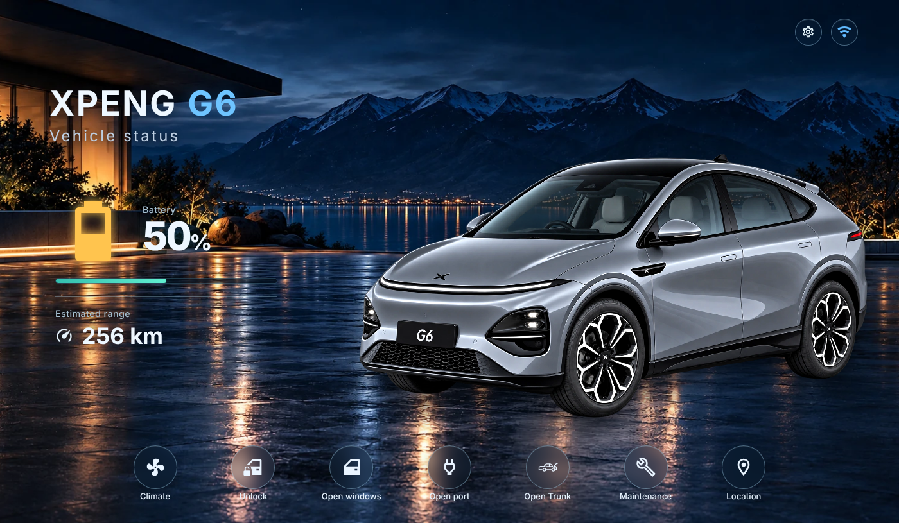 | 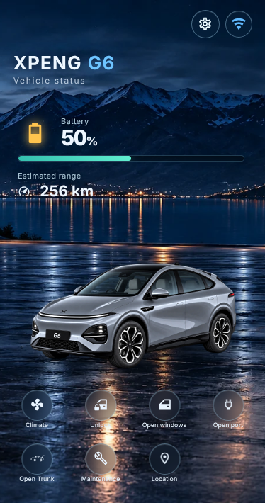 |
| Charging | 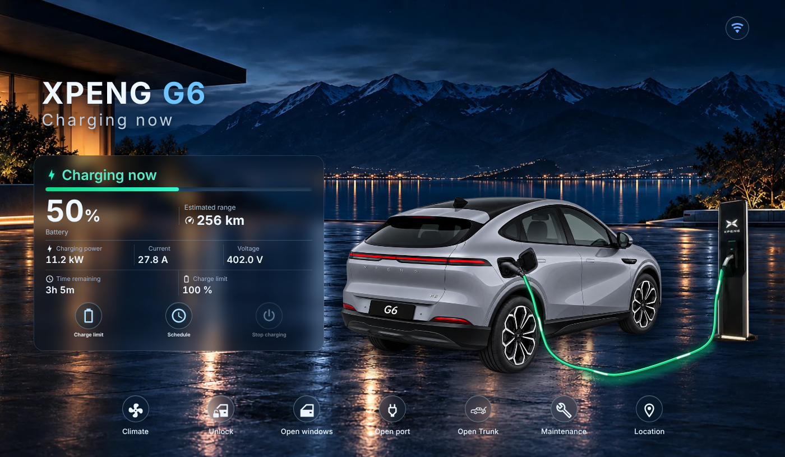 | 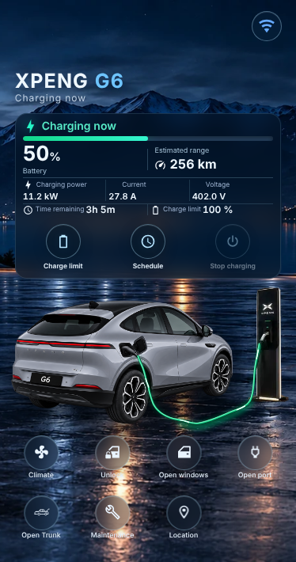 |
| Climate | 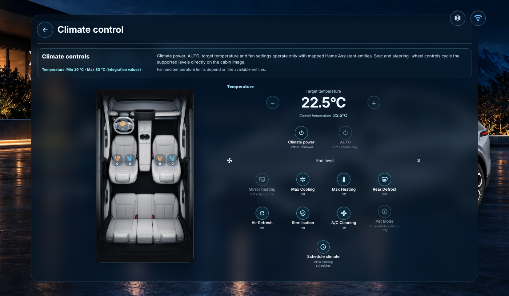 | 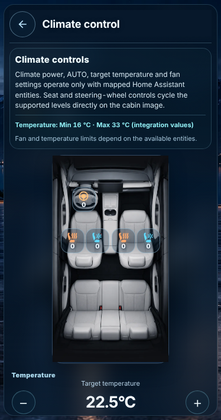 |
| Maintenance and tire pressure | 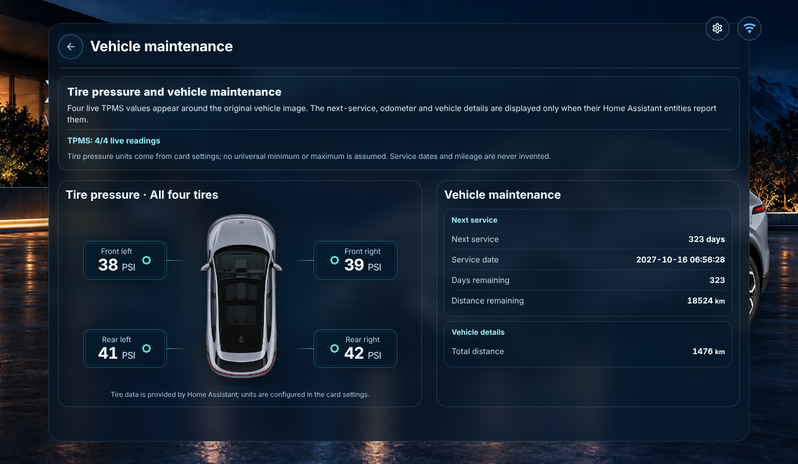 | 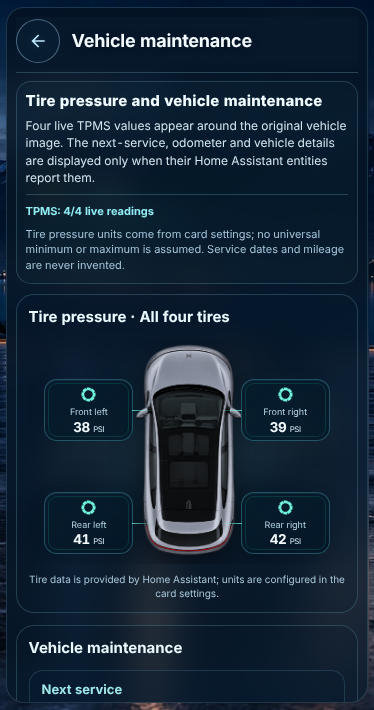 |
| Location, horn and flash | 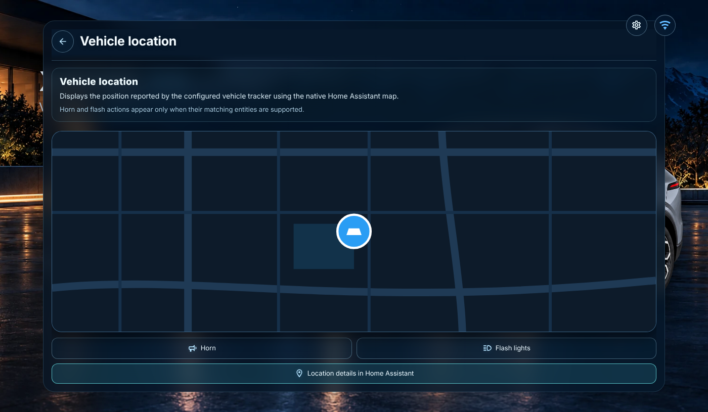 | 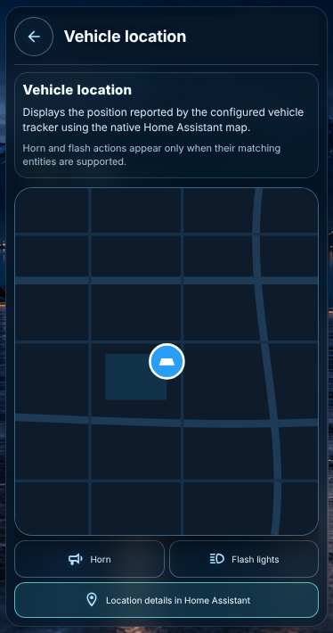 |
| More options | 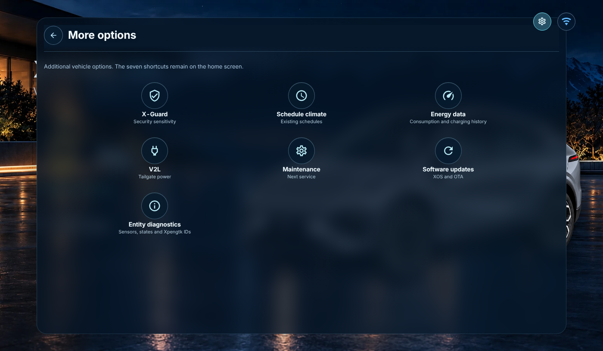 | 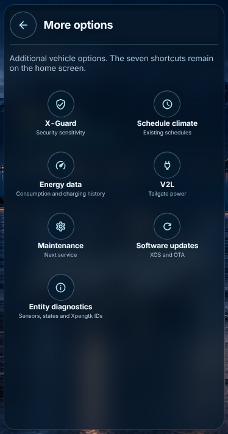 |

| Charge limit and schedules | Entity diagnostics |
| :---: | :---: |
| 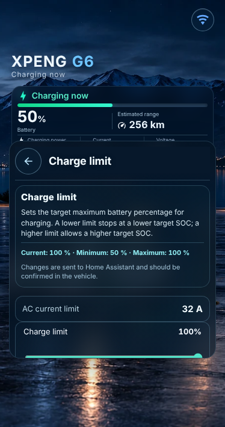 | 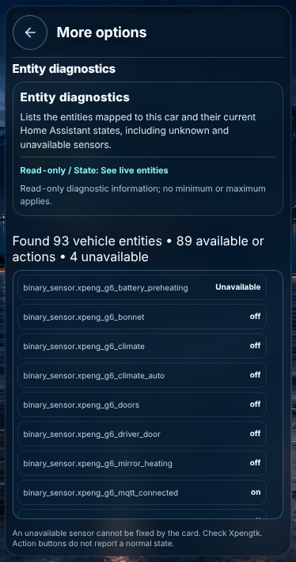 |

## Features

- **Home:** battery and range, connection state, the car's picture in your model, year and paint, and seven shortcuts (climate, lock, windows, charge port, trunk, maintenance, location).
- **Charging:** switches on by itself while the car charges. Shows charging power, current and voltage, time left and charge limit, with charge limit, schedule and stop buttons when your integration supports them.
- **Climate:** target temperature, fan, heating and cooling, front seat heating and ventilation, rear seat heating and the heated steering wheel, on a picture of the cabin.
- **Maintenance:** live pressure of all four tires (bar, PSI or kPa), next service, odometer and vehicle details.
- **Location:** the car on the Home Assistant map, with horn and flash.
- **More options:** other vehicle settings, software update information and entity diagnostics.
- **Visual editor:** model, year, trim, paint, interior colour (dashboard, steering wheel, door inserts, console and seats), tire unit, controls, and manual mapping of every sensor.

## Requirements

The **Xpengtk** Home Assistant integration, installed and signed in to your XPENG account. The card reads its entities and calls its actions. It doesn't connect to XPENG itself.

## Installation

### HACS (recommended)

<a href="https://my.home-assistant.io/redirect/hacs_repository/?owner=matanmesika&repository=xpeng-vehicle-card&category=plugin"></a>

1. Click the button above, or in **HACS → ⋮ → Custom repositories** add `https://github.com/matanmesika/xpeng-vehicle-card` with type **Dashboard**.
2. Find **XPENG Vehicle Card** and choose **Download**.
3. Reload the browser (on the phone app: close and reopen it).

### Manual

Copy `dist/xpeng-vehicle-card.js` to `<config>/www/xpeng-vehicle-card/`, then add `/local/xpeng-vehicle-card/xpeng-vehicle-card.js` as a **JavaScript module** under **Settings → Dashboards → ⋮ → Resources**.

## Setup

### Automatic

Add the card from the dashboard editor (**Add card → XPENG Vehicle Card**), or with YAML:

```yaml
type: custom:xpeng-vehicle-card
prefix: xpeng_g6          # the start of your Xpengtk entity IDs, e.g. sensor.xpeng_g6_battery
model: G6
year: "2026"
color: graphite_gray
interior: light_gray
```

In automatic mode the card finds the Xpengtk entities that start with your `prefix`.

### Manual (visual editor or YAML)

| Visual editor |
| :---: |
| 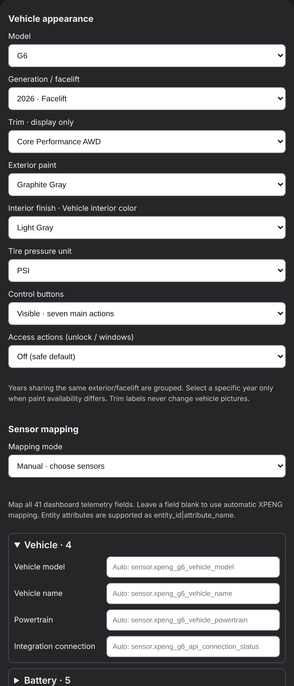 |

In the editor, set **Mapping mode** to *Manual · choose sensors* and pick any of the 41 sensors yourself. A field left blank keeps the automatic mapping. A value can also be an attribute, written as `entity_id|attribute_name`.

```yaml
type: custom:xpeng-vehicle-card
prefix: xpeng_g6
model: G6
year: "2026"
trim: core_performance_awd
color: graphite_gray
interior: light_gray
tire_pressure_unit: psi
show_controls: true
enable_access_controls: false
sensor_mapping_mode: manual
entities:
  soc: sensor.xpeng_g6_battery
  range: sensor.xpeng_g6_range
  tire_fl: sensor.xpeng_g6_tyre_pressure_front_left
```

### Options

| Option | Default | Description |
| --- | --- | --- |
| `prefix` | `my_xpeng` | The start of your Xpengtk entity IDs. |
| `model`, `year`, `trim` | `G6`, `2026` | Choose the car's picture. Trim is shown as a label only. |
| `color`, `interior` | `graphite_gray`, `dark_gray` | Exterior paint and interior colour of the pictures. |
| `tire_pressure_unit` | `bar` | `bar`, `psi` or `kpa`. |
| `show_controls` | `true` on G6 | Shows the seven shortcut buttons. |
| `enable_access_controls` | `false` | Allows unlock and window actions. Needs Xpengtk access permission. |
| `sensor_mapping_mode` | `auto` (`manual` when `entities` is set) | `auto` finds entities by `prefix` and ignores `entities`; `manual` uses `entities` first and finds the rest by `prefix`. |
| `entities` | — | Manual sensor mapping (see below). |

### Sensors the card uses

All of them are optional. A sensor that's missing hides its row instead of showing a wrong value.

| Group | Keys |
| --- | --- |
| Vehicle | `model`, `name`, `powertrain`, `connection` |
| Battery | `soc`, `health`, `battery_voltage`, `battery_current`, `battery_12v` |
| Range | `range`, `fuel`, `fuel_range`, `combined` |
| Charging | `charging`, `plugged`, `target`, `power`, `energy`, `remaining`, `current`, `current_limit`, `voltage` |
| Vehicle status | `odometer`, `speed`, `locked`, `door_fl`, `door_fr`, `door_rl`, `door_rr`, `trunk`, `hood`, `location`, `last_update` |
| Climate | `climate`, `cabin`, `outside`, `fan_speed` |
| Tires | `tire_fl`, `tire_fr`, `tire_rl`, `tire_rr` |

## Status

**G6 functional mapping status: COMPLETE.** The artwork inventory has 30/33 G6 views. The other 14 vehicle families still have incomplete pictures, so the card is tuned for the G6. See [artwork status](https://github.com/matanmesika/xpeng-vehicle-card/blob/main/docs/ARTWORK_STATUS.md), [entity mapping](https://github.com/matanmesika/xpeng-vehicle-card/blob/main/docs/XPENG_APP_FEATURE_MAP.md) and the [Xpengtk entity catalogue](https://github.com/matanmesika/xpeng-vehicle-card/blob/main/docs/XPENGTK_ENTITY_CATALOG.md).

## Troubleshooting

- **Rows are empty:** check that `prefix` matches your entity IDs (*Developer Tools → States*), or map the sensors manually in the editor.
- **Unlock or windows are missing:** turn on `enable_access_controls`, and check that your Xpengtk account has access permission.
- **An old version still shows after an update:** reload the browser, or close and reopen the phone app.

## License

[MIT](https://github.com/matanmesika/xpeng-vehicle-card/blob/main/LICENSE) © 2026 Matan Mesika

This is an unofficial project, not affiliated with or endorsed by XPENG.
