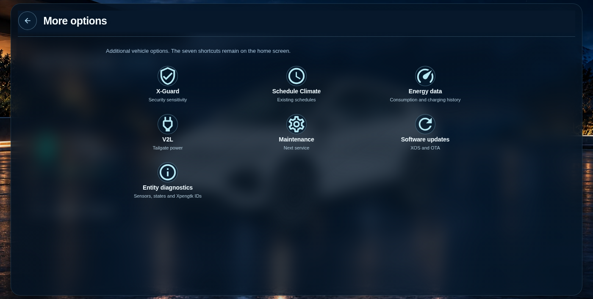
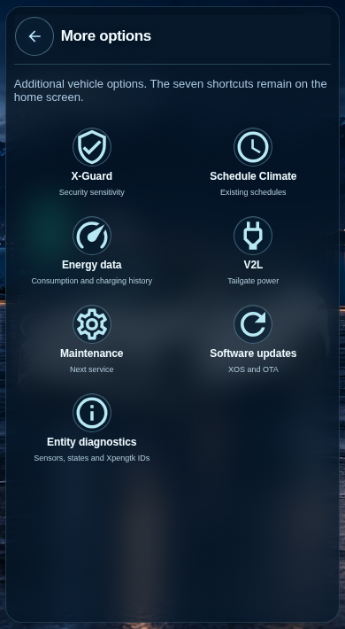

# XPENG Vehicle Card for Home Assistant

**An unofficial, responsive vehicle dashboard for Home Assistant, powered by existing Xpengtk entities.** One Lovelace card automatically adapts to desktop, iPhone, and narrow Home Assistant Sections layouts. There is no separate mobile dashboard.

The card preserves the night-lakeside setting, the selected vehicle artwork, and entity-driven controls. When the vehicle reports active charging, it automatically switches to a dedicated charging scene with a photographic XPENG charging station, a green cable overlay, and live charging information.

**Stable release: [v1.0.6](https://github.com/matanmesika/xpeng-vehicle-card/releases/tag/v1.0.6). Current opt-in beta: [v1.0.7-beta.5](https://github.com/matanmesika/xpeng-vehicle-card/releases/tag/v1.0.7-beta.5).** Previous stable: [v1.0.5](https://github.com/matanmesika/xpeng-vehicle-card/releases/tag/v1.0.5). Historical releases and betas remain available for rollback. The charging block uses one shared responsive component for desktop, iPhone and Home Assistant Sections.

[Install with HACS](https://my.home-assistant.io/redirect/hacs_repository/?owner=matanmesika&repository=xpeng-vehicle-card&category=plugin) · [HACS product guide](docs/HACS_STORE_GUIDE.md) · [Screenshot gallery](docs/screenshots/README.md) · [Release acceptance](docs/G6_FINAL_STABILIZATION.md)

## Actual dashboard screenshots

Screenshots below were captured from **the running card in Chromium**, with simulated Home Assistant/Xpengtk sensor values. They are not recreated screenshots or AI-generated interface mockups. Vehicle and charging-station artwork may itself be illustrative; the browser tests do not prove live vehicle commands. The standalone map capture uses a placeholder map; actual map tiles and GPS centering require Home Assistant.

| Screen | Desktop | Mobile |
| --- | --- | --- |
| Overview and seven shortcuts |  |  |
| Automatic charging — grouped Power (kW), Current (A), Voltage (V), time and limit |  |  |
| HVAC, cabin seats and steering-wheel controls |  |  |
| Four tires and available maintenance data |  |  |
| Location and supported horn/flash commands |  |  |
| More Options and supported Xpengtk controls |  |  |

[Charge limit and schedules](docs/screenshots/charge-controls-mobile.png) · [Entity diagnostics](docs/screenshots/diagnostics-mobile.png)

## Install and configure

In **HACS → Custom repositories**, add `https://github.com/matanmesika/xpeng-vehicle-card` under **Dashboard**. Install a stable release or explicitly select a beta using **Redownload → Need a different version?**. Reload Home Assistant's frontend after updating; a hard refresh may be necessary to clear a cached JavaScript bundle.

Add a card via the visual editor, or use YAML:

```yaml
type: custom:xpeng-vehicle-card
model: G6
year: "2026"
color: graphite_gray
interior: dark_gray
prefix: xpeng_g6  # Example only; match your actual Xpengtk entity names
show_controls: true
enable_access_controls: false
grid_options:
  columns: full
  rows: auto
```

The prefix, model/year/paint and actual available entities must match your installation. The interior color is selected in the **card editor**, not in the Climate screen. Access actions require both the integration's permissions and an explicit card setting.

**Dependency:** an independently installed, configured and authenticated Xpengtk Home Assistant integration providing the supported entities. This is a *frontend card*, not a vehicle integration, API client, account login or credential-renewal service.

## What the card can display and control

- **Overview:** battery and range, connection state, approved vehicle artwork and seven compact shortcuts.
- **Charging:** automatically shown while the charging sensor reports an active state. The electrical row groups **Charging power (kW), Current (A), and Voltage (V)**, with **Time remaining** and **Charge limit** together below. Battery percentage and estimated range remain above. Current and Voltage display `0.0 A` and `0.0 V` if their mapped readings are missing or invalid; these are **display placeholders, not measured zeroes**. Charging limits, schedules and stop/release actions appear only when supported.
- **Climate:** supported temperature, fan, heating/cooling, front-seat heat/ventilation, rear-seat heating and heated steering wheel using mapped Home Assistant entities. A control is not proof that an unsupported physical feature exists.
- **Vehicle actions:** lock/unlock, windows, trunk and charge flap through actual supported entities. State-sensitive action labels and pending-command suppression help avoid duplicate commands.
- **Maintenance:** four live tire pressure sensors with unit preferences plus odometer, service information and identity only when the integration supplies them.
- **Location:** native Home Assistant tracker map and horn/flash when the correct entities and permissions are available.
- **More Options:** supported vehicle settings, Software Updates information and diagnostics. No unsupported manual software-update command is invented.

All dashboard, editor, help and error labels are **English-only** regardless of the Home Assistant interface language. Unknown or unavailable entity states are normally shown as unavailable; the **Charging Current and Voltage** tiles specifically use `0.0` as a display-only fallback. The card does not infer actual electrical measurements or guarantee control execution.

## Sensor mapping and support

The card reads **existing Home Assistant/Xpengtk entities** and never independently polls XPENG servers. Check **Developer Tools → States** and the card's Entity Diagnostics to verify your entity IDs and vehicle feedback. A successful Home Assistant service call means the command was accepted by Home Assistant; it does not establish that the vehicle executed it.

The card is presently optimized for the G6. **G6 functional mapping status: COMPLETE** for the implemented and simulated-tested card features, *subject to real vehicle approval*. The artwork inventory separately records **30/33 G6 views**, with three G6 views still missing; the **other 14 vehicle families** have unfinished image coverage or verification. The interface does not substitute another model's images to hide missing artwork.

[Artwork status](docs/ARTWORK_STATUS.md) · [Entity mapping](docs/XPENG_APP_FEATURE_MAP.md) · [Complete Xpengtk entity catalogue](docs/XPENGTK_ENTITY_CATALOG.md) · [Feature and safety notes](docs/HACS_STORE_GUIDE.md)

## Quality assurance and release status

The automated suite checks source/dist parity, frontend syntax, HACS metadata, vehicle-image inventory, action and permission safeguards, English-only content, responsive geometry at desktop and 320/390/420px, and **14 browser screenshots**. These use simulated vehicle states and are not evidence of real-car execution.

For `v1.0.6`, the owner approved the grouped electrical charging layout and requested a stable release. Chromium browser captures validate the frontend layout, but on-device Home Assistant, iPhone Safari, GPS, TPMS and supported vehicle commands still require real-world verification.

[Owner acceptance checklist](docs/G6_FINAL_STABILIZATION.md) · [Browser screenshot index](docs/screenshots/README.md)

## Developer structure

The executable card runtime is maintained in `src/core/`, visual CSS in `src/design/`, and the distributable bundle in `dist/` with a matching entrypoint in `src/`. `assets/` contains backgrounds, cabin photos and vehicle imagery; `tests/` and `scripts/` contain regressions and reproducible browser captures. Some artwork is illustrative or unverified; view provenance and licensing before reusing assets outside this project.

This community project is **not affiliated with or endorsed by XPENG**.
