# XPENG Vehicle Card for Home Assistant

**A responsive, bilingual vehicle dashboard with a single card for desktop, iPhone, and Home Assistant Sections.**

The XPENG Vehicle Card is a custom Lovelace frontend for vehicles exposed through the separate **Xpengtk Home Assistant integration**. It displays real vehicle states and provides supported controls without creating a second phone dashboard or replacing the owner's original night-lakeside visual design.

[Install using HACS](https://my.home-assistant.io/redirect/hacs_repository/?owner=matanmesika&repository=xpeng-vehicle-card&category=plugin) · [Latest stable: v1.0.3](https://github.com/matanmesika/xpeng-vehicle-card/releases/tag/v1.0.3) · [Test beta: v1.0.4-beta.10](https://github.com/matanmesika/xpeng-vehicle-card/releases/tag/v1.0.4-beta.10) · [English screenshot gallery](docs/gallery-en/README.md) · [English installation guide](docs/G6_DASHBOARD_GUIDE_EN.md)

> **Release status:** v1.0.3 remains the stable release. Beta.10 is an opt-in test release containing updated G6 layouts, icon labels, diagnostics, charging and HVAC presentation. Beta testing does not establish that a physical car executed a service command. Black Edition-specific photo artwork remains incomplete.

## Dashboard preview

The following **12 images** were captured from the actual running card JavaScript with simulated Home Assistant/Xpengtk sensor values, in **English**. They are not AI-generated interface mockups and they do not show the owner's private live telemetry. The standalone Location view uses a map placeholder; real GPS map tiles must be verified inside Home Assistant.

### Main dashboard and automatic charging

| Vehicle status | Automatic charging |
| --- | --- |
| 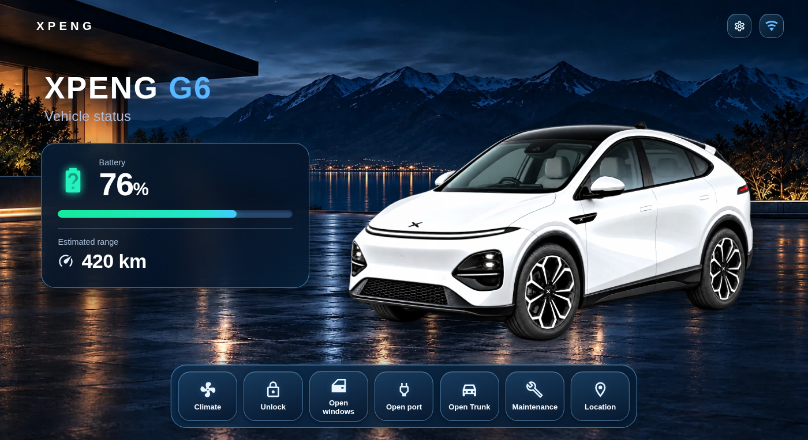 | 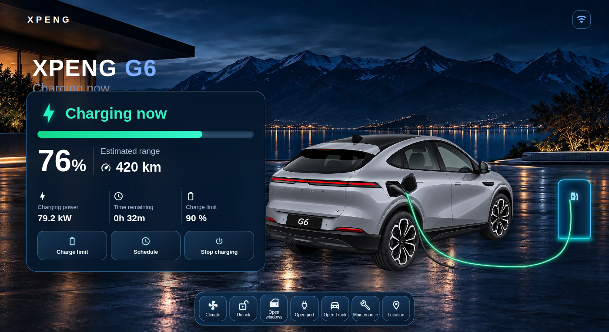 |

| Vehicle status on phone | Charging on phone |
| --- | --- |
| 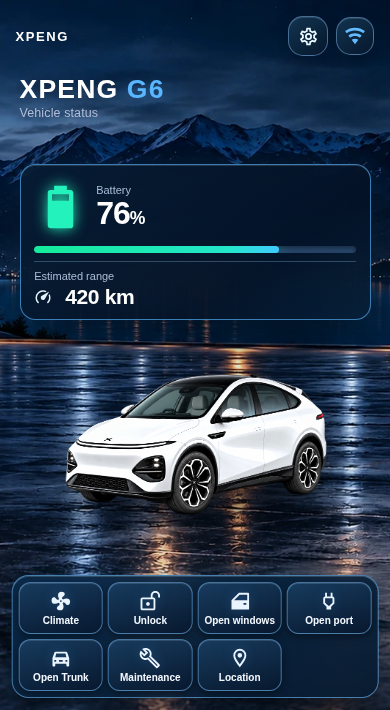 | 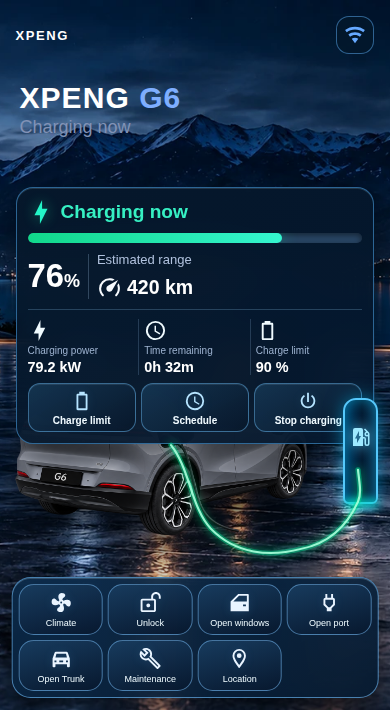 |

Charging switches automatically when confirmed live charging is detected. The dedicated rear charging image and the night background remain unchanged. A thin cable becomes green only during active charging. Both views have the same seven quick actions.

### Climate and seat comfort

| Desktop | Phone |
| --- | --- |
| 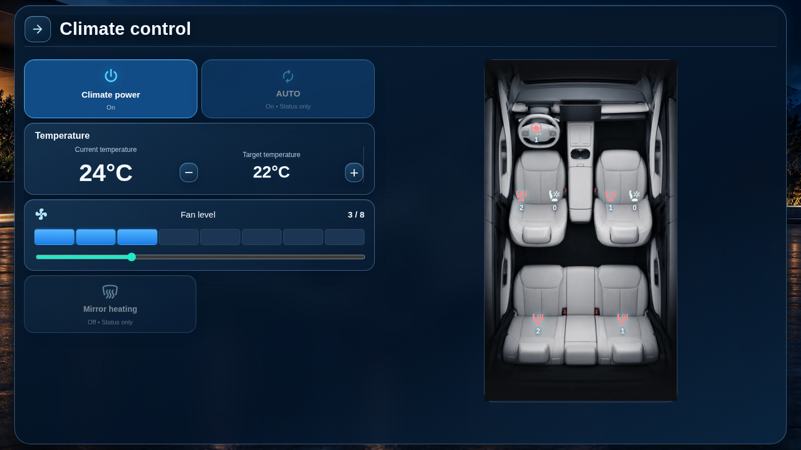 | 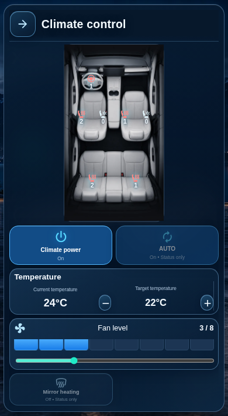 |

The light/dark cabin finish is selected in card settings, not on the climate screen. Supported front-seat heating and ventilation, rear-seat heating, and steering-wheel heating are activated directly at their physical locations on the original cabin photograph. Power, temperature, fan levels, defrost and AUTO feedback depend on available Home Assistant entities.

### Maintenance and tire pressure

| Desktop | Phone |
| --- | --- |
| 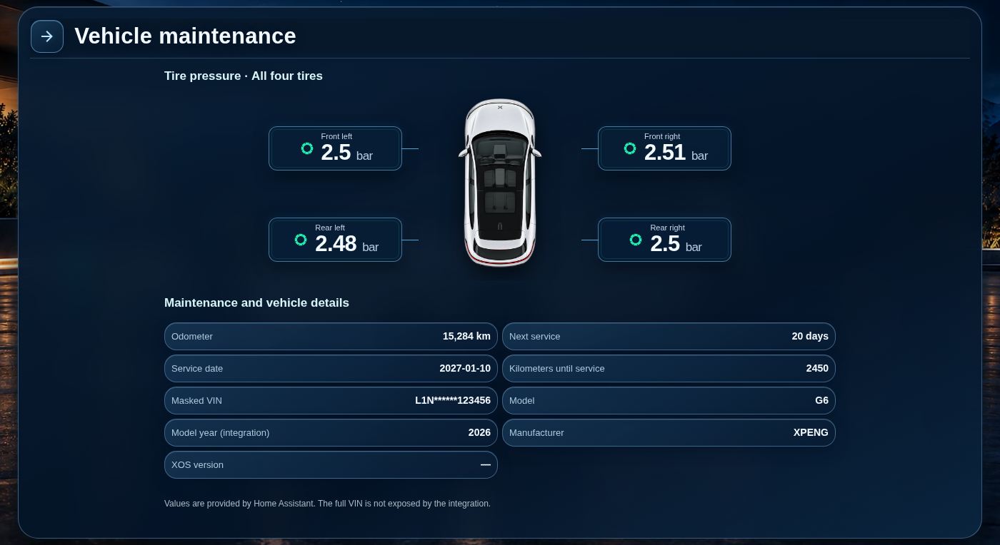 | 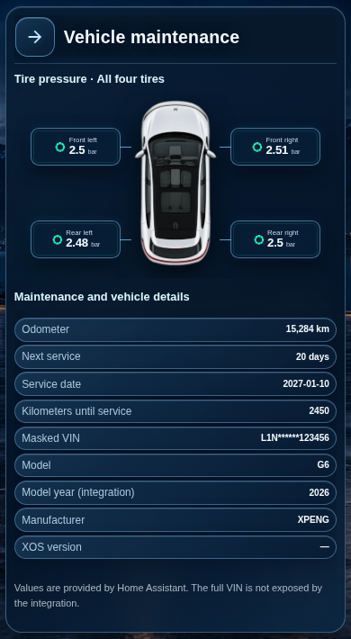 |

The four TPMS readings appear beside their corresponding wheels. Pressure unit selection is in the card editor. Vehicle details use real Xpengtk states when available; no unavailable value is simulated as a live measurement.

### Location, horn and flash

| Desktop | Phone |
| --- | --- |
|  | 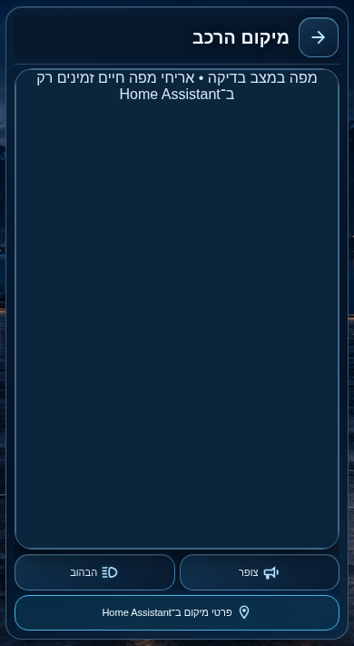 |

The actual card mounts Home Assistant's native map using the selected vehicle's device tracker. Horn and flash buttons are available only if their real service entities exist. **The maps pictured above are test placeholders, not live map tiles.**

### Charging settings and entity diagnostics

| Charging controls on phone | Xpengtk entity diagnostics on phone |
| --- | --- |
| 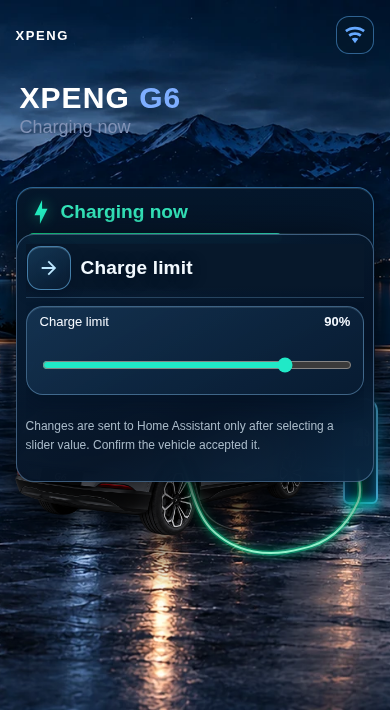 | 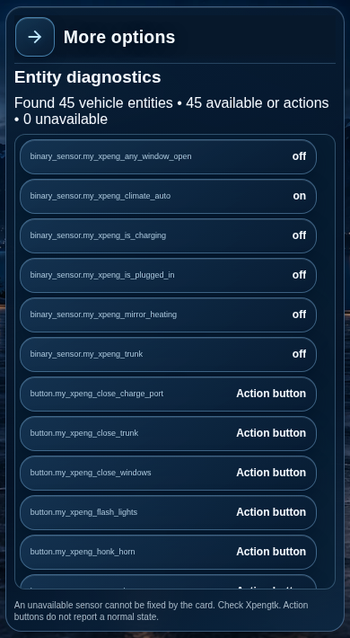 |

These are the remaining two screenshots in the curated set. [Open the full English screenshot gallery](docs/gallery-en/README.md).

## Seven direct actions

| Action | Behavior |
| --- | --- |
| **Climate** | Current/target temperature, supported fan speed and comfort features |
| **Lock / Unlock** | One-tap action driven by real lock state and permissions |
| **Windows** | State-dependent open or close; no command if the state is unknown |
| **Charging port** | Open/close the flap only when safe; never close with a connected cable |
| **Open Trunk / Close Trunk** | Direct state-dependent tailgate action; no duplicate page |
| **Maintenance** | Tire pressures and available vehicle/service details |
| **Location** | Native Home Assistant location map, horn and flash when supported |

The buttons are present on both Vehicle status and Charging. Subpages have a Back arrow. The same card automatically responds to available width, including narrow Home Assistant Sections layouts; no separate mobile configuration is needed.

## Install through HACS

1. Open **HACS → Custom repositories**.
2. Add `https://github.com/matanmesika/xpeng-vehicle-card` and select **Dashboard**.
3. Install **XPENG Vehicle Card**. Refresh the Home Assistant browser or mobile app after installation.
4. Add the card to your dashboard and configure its model, year, paint, interior finish and sensor mapping.
5. To try Beta.10, open the card in HACS → **⋮ → Redownload → Need a different version?** → select `v1.0.4-beta.10`. To roll back, select `v1.0.3`.

Example configuration (replace the prefix with your actual Xpengtk entity prefix):

```yaml
type: custom:xpeng-vehicle-card
model: G6
year: "2026"                # Image/catalog selection
prefix: xpeng_g6           # Match your Home Assistant entities
color: graphite_gray
interior: light_gray
show_controls: true
enable_access_controls: false
grid_options:
  columns: full
  rows: auto
```

**Xpengtk is a separate prerequisite.** This card does not authenticate to XPENG, install the backend integration or provide missing vehicle commands. Opening/unlocking controls require explicit Access permission in the integration and card. Never enable remote commands unless you understand the effect and have tested them safely while parked.

## Sensor mapping and real command feedback

The card reads existing Xpengtk entities, including renamed entities resolved through Home Assistant's Entity Registry where available. Check **Developer Tools → States** and **Entity diagnostics** for the actual entity IDs. Missing, unknown or unavailable states remain unavailable; the frontend cannot repair an offline upstream sensor.

Calling a Home Assistant service successfully **does not prove that the physical vehicle completed the action**. Where possible, verify command feedback and the corresponding live state change before treating it as completed. Nonessential success notifications are suppressed, while errors and safety warnings remain visible.

## Models, imagery and known limitations

The G6 frontend mapping and its responsive screens are implemented and tested with simulated telemetry, but model imagery is not universally complete. The most recent G6 inventory recorded **30 of 33 required camera views** across its mapped paint combinations. Approved dedicated **Black Edition** exterior/interior photographs are still missing; a dark appearance treatment is not equivalent to genuine approved Black Edition photography. Other XPENG model families have partial image coverage.

The original night-lakeside background, G6 vehicle images, and owner-provided cabin photographs are preserved. Artwork selection follows model, body generation/year group and paint color; no image for a different color is presented as an authenticated original.

Automated checks cover JavaScript/HACS packaging, regression tests and browser layout at desktop, iPhone and Sections widths. **Real iPhone Safari, the native HA GPS map and physical vehicle actions still require on-device verification.** See the [artwork inventory](docs/ARTWORK_STATUS.md), [source provenance](docs/ARTWORK_PROVENANCE_REVIEW.md) and [English image gallery](docs/gallery-en/README.md).

## Development

`src/xpeng-vehicle-card.js` is the maintained source and `dist/xpeng-vehicle-card.js` is the bundled HACS frontend. Browser screenshots are generated by `scripts/capture-dashboard.cjs` with Playwright and official Material Design icons. Images in `docs/gallery-en/` are documentation assets only; live vehicle artwork in `assets/` is kept separate.

This repository provides the vehicle **frontend card**, not the Xpengtk backend. Stable and beta releases remain independently selectable in HACS.
