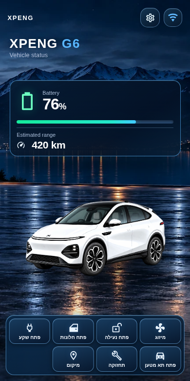
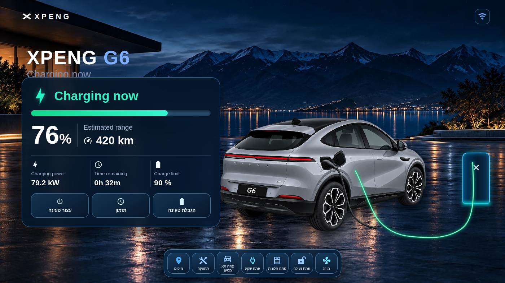
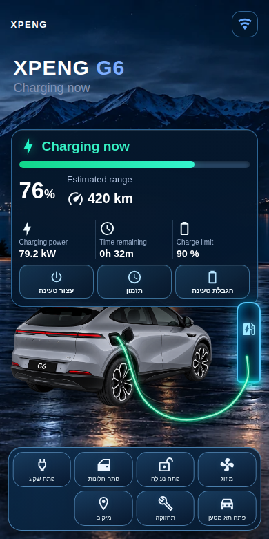
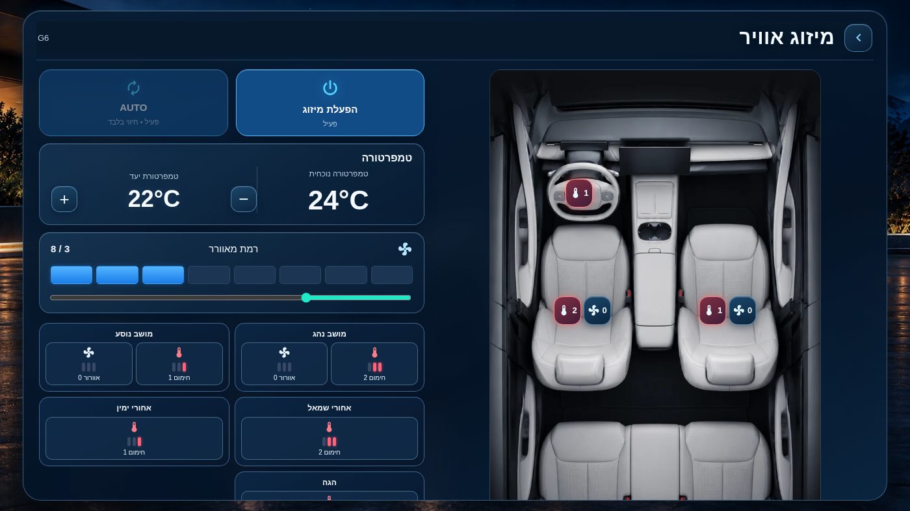
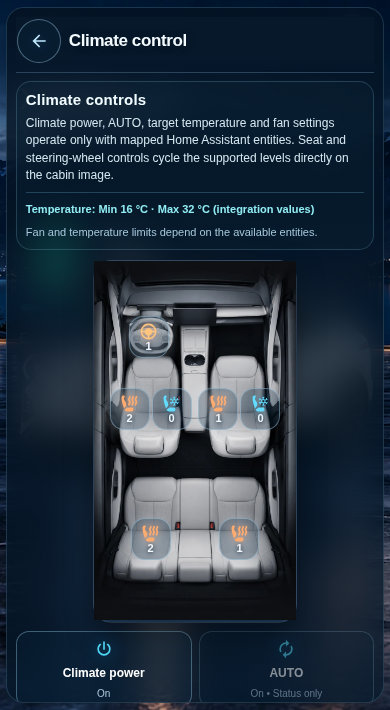
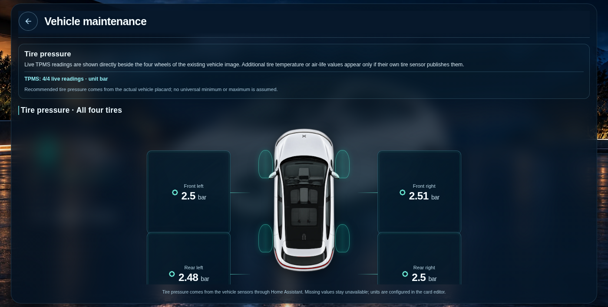
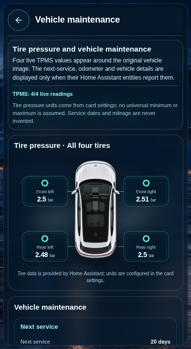
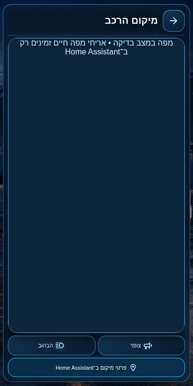

# XPENG Vehicle Card for Home Assistant

A responsive, bilingual Lovelace card for XPENG vehicles, built for the native **Home Assistant Sections dashboard**, desktop browsers and iPhone. One card adapts automatically to the available width, with the original night-lakeside dashboard, original vehicle artwork and live Home Assistant/Xpengtk sensors.

**Project status (18 October 2026):** the **G6 dashboard and Xpengtk entity/control mapping is implemented and tested with simulated telemetry**. The current prerelease is **[v1.0.4-beta.9](https://github.com/matanmesika/xpeng-vehicle-card/releases/tag/v1.0.4-beta.9)**; the stable HACS release is still **[v1.0.3](https://github.com/matanmesika/xpeng-vehicle-card/releases/tag/v1.0.3)**. The current development branch also includes owner-reviewed fixes for the climate layout, maintenance, dynamic battery status, diagnostic rows, exact English **Open Trunk** label, and Black Edition cabin styling; they are not yet part of a tagged release. A full stable release is **not yet approved or merged**.

[Install in HACS](https://my.home-assistant.io/redirect/hacs_repository/?owner=matanmesika&repository=xpeng-vehicle-card&category=plugin) · [מדריך בעברית](docs/G6_DASHBOARD_GUIDE_HE.md) · [Release readiness / מוכנות לשחרור](docs/G6_RELEASE_READINESS_HE.md) · [Screenshot gallery](docs/screenshots/README.md)

## Screenshots — real card in browser, simulated XPENG sensors

All captures are from the **running card JavaScript in Chromium**, with synthetic Home Assistant/Xpengtk entity states; they are not AI-generated UI mockups and do not represent the owner's live vehicle. **The Location map in standalone tests uses a stub**; real map tiles can be verified only inside Home Assistant. These are the 12 curated screenshots for current release-review UI.

| Screen | Desktop | Mobile |
| --- | --- | --- |
| Home · seven shortcuts |  |  |
| Automatic charging · dedicated G6 charging scene |  |  |
| Climate · seats and steering wheel |  |  |
| Maintenance · four TPMS wheel readings |  |  |
| Location · HA native map / horn / flash |  |  |

**Other relevant views:** [charging limits and schedules](docs/screenshots/charge-controls-mobile.png) · [Xpengtk entity diagnostics](docs/screenshots/diagnostics-mobile.png). The direct vehicle actions (doors/lock, windows, charge flap and tailgate) are interactive buttons rather than separate permanent navigation screens; they are covered by functional QA. See [the gallery guide](docs/screenshots/README.md) for the complete set and limitations.

## Installation and configuration

In **HACS → Custom repositories**, add `https://github.com/matanmesika/xpeng-vehicle-card` with category **Dashboard**. Install the latest stable release or explicitly select a beta under **Redownload → Need a different version?**. Refresh Home Assistant and clear the app/browser cache after updating.

```yaml
type: custom:xpeng-vehicle-card
model: G6
year: "2026"
prefix: my_xpeng  # Replace with your actual Xpengtk entity prefix
color: graphite_gray
interior: dark_gray
show_controls: true
enable_access_controls: false
grid_options:
  columns: full
  rows: auto
```

The card is **a frontend**, not the Xpengtk backend integration. It does not install or update the vehicle integration. Real commands require Xpengtk service entities; opening/unlocking actions additionally require explicit **Access** permissions in both the integration and card settings. Unknown/unavailable sensor values never trigger guessed actions.

## Seven shortcuts and responsive screens

| Shortcut | What it does |
| --- | --- |
| Climate / מיזוג | Live cabin temperature, fan, supported HVAC, seat heating/cooling and steering-wheel heating using real integration entities; seat actions only at their physical positions in the cabin photo |
| Lock / נעילה | State-dependent lock/unlock with duplicate-command suppression |
| Windows / חלונות | State-dependent open/close, official `mdi:car-door` icon |
| Charge flap / שקע טעינה | State-dependent flap, refusing unsafe close with connected cable |
| Tailgate / תא מטען | State-dependent open/close, official `mdi:car-hatchback` icon; English **Open Trunk** label |
| Maintenance / תחזוקה | Four wheel-positioned TPMS readings, odometer, identity/maintenance data |
| Location / מיקום | Native Home Assistant GPS map, preloaded map helpers, horn and flash when available |

The same seven actions appear on the Home and charging scenes. The charging scene is chosen **automatically** only from confirmed active charging; it uses its own rear-three-quarter photo and a thin **green cable only during charging**. There is no manual Charging navigation button.

All modal screens fit **within the available card scene** in tested desktop and 320–420px-wide responsive layouts. **Only the compact sensor list within Entity diagnostics scrolls**, keeping the note and status summary visible. The Wi-Fi symbol is centered in its square, and the cog has deliberate spacing. `getGridOptions()` follows the HA Sections card sizing API; there is no second mobile dashboard.

The UI supports **Hebrew RTL** and **English LTR**, automatically following the Home Assistant user's language; controls and artwork are shared. Cabin color is an **editor setting only**, not a Climate-screen selector. In G6 Climate, the owner-provided light/dark interior photos have **no captions over the photo**; images retain screen-reader alt descriptions.

## Owner screenshot fixes — in testing only

The current development branch `fix/g6-visual-live-feedback-20261018` is under visual acceptance: a larger status-dependent official MDI battery icon, properly aligned maintenance tire geometry and details, narrow-screen climate controls without horizontal spill, transparent seat/wheel hotspots, centered one-row-per-entity diagnostics, English OTA “Update details,” and silence after routine successful commands. These fixes are backed by simulated browser QA and still require real Home Assistant/iPhone confirmation.

**Black Edition:** the UI now selects the dark G6 cabin and an all-black appearance treatment. Approved dedicated Black Edition front/charging/overhead imagery has **not** been uploaded; the card must show an honest missing-image fallback rather than borrowing Graphite Gray charging artwork.

## G6 mapping finished; model artwork remains to be specified

**G6 functional mapping status: COMPLETE for the current card.** The G6 screen structure, auto charge status, core sensors, entity diagnostics, available Xpengtk operations, vehicle photos selected by model/year/paint, TPMS and localized labels are implemented and regression-tested. Real vehicle/HA/iPhone approval is still a **release gate**, not something automated testing can replace.

**Artwork catalogue status is separate from functional mapping.** The checked-in inventory currently records **G6: 30/33 camera views across 10/11 paint combinations**, with **3 views still missing for one 2026 color**. Do not mark those missing assets as completed. The **other 14 vehicle families still require image characterization, approval and completion** by model, body generation, exterior paint and camera angle. Some currently have partial illustrative previews; they are not production-approved manufacturer photos. Missing artwork must never be falsely substituted with a different model or angle.

See [current artwork status](docs/ARTWORK_STATUS.md), [generation/paint mapping](docs/ARTWORK_MAPPING.md), [master-view queue](data/master-view-queue.json) and [photo provenance](docs/ARTWORK_PROVENANCE_REVIEW.md). Source images and all `assets/vehicles/` subdirectories are intentionally retained until those gaps are closed.

## Testing, privacy and full-release gate

Automated QA validates JavaScript source/distribution parity, HACS metadata, true MDI icons, telemetry aliases, permission-gated actions, responsive desktop/mobile/Sections layouts, all subpage content fitting, map-host reuse, bilingual UI and curated Chromium screenshots. Fake Xpengtk states are used in tests; no vehicle actions are sent to the physical car.

**Before stable release:** install the candidate in the owner's real HA, verify the native map tiles, iPhone Safari rendering, real lock/window/port/TPMS entities, climate/seat controls, charging transition and image quality. Obtain explicit approval before merging to `main` or changing stable HACS. [Hebrew acceptance checklist](docs/G6_BETA_LIVE_ACCEPTANCE_HE.md) · [Draft pull request #44](https://github.com/matanmesika/xpeng-vehicle-card/pull/44).

## Developer layout / folders

`src/` is the maintained source, `dist/` the byte-identical HACS frontend. `assets/` holds approved backgrounds, owner cabin images and the model/year/paint artwork collection. `data/`, `profiles/` and `sources/` hold the **still-active** generation/asset inventories, provenance and pending-image queue; `tools/` rebuild and audit them. `tests/` contains maintained regression suites and simulator fixtures, `scripts/` capture actual browser visuals, `docs/screenshots/` holds **only 12 curated gallery images**, and `docs/releases/` is historical documentation. Historical pre-v1 test suites and obsolete alpha publishing workflows have been removed from this maintenance branch; release history/tags remain available on GitHub.
