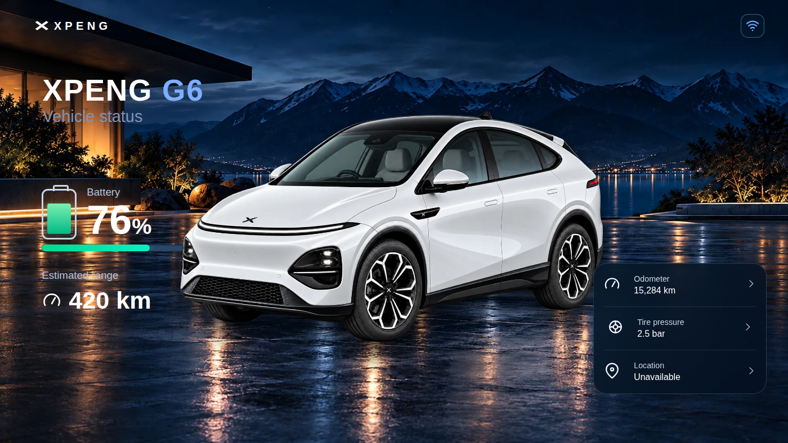

# XPENG Vehicle Card — Home Assistant Dashboard

A responsive Lovelace card for XPENG vehicles. The G6 includes automatic charging mode, live climate and seat controls, vehicle maintenance/TPMS, location, horn and flash, and status-dependent access commands. This is the FRONTEND card; it does not change Xpengtk vehicle integration or install it for you.

[Install via HACS](https://my.home-assistant.io/redirect/hacs_repository/?owner=matanmesika&repository=xpeng-vehicle-card&category=plugin) · [Release v1.0.3](https://github.com/matanmesika/xpeng-vehicle-card/releases/tag/v1.0.3) · [מדריך בעברית](docs/G6_DASHBOARD_GUIDE_HE.md) · [Release notes](docs/releases/v1.0.3.md)

## Screenshots from the real card code (synthetic HA telemetry)

All images below were captured by Chromium while running the actual card JavaScript with test sensor values, NOT an image-generator mockup or the owner's real car telemetry. The standalone location test substitutes a clearly marked placeholder for the native Home Assistant map card: real tiles appear only after installing inside HA.

| Page | Desktop | Phone |
| --- | --- | --- |
| **Home: eight shortcuts** |  |  |
| **Charging** |  |  |
| **Climate, light cabin** |  |  |
| **Climate, dark cabin** |  |  |
| **Location, horn and flash** |  |  |
| **Maintenance and tires** |  |  |

Additional screenshots: [action labels when open](docs/screenshots/g6-2026-home-close-actions-desktop.png), [tailgate on phone](docs/screenshots/g6-2026-trunk-mobile.png), [charge limit](docs/screenshots/g6-2026-charging-actions-mobile.png), and [schedule](docs/screenshots/g6-2026-charge-schedule-mobile.png).

## Install and update

Home Assistant → HACS → custom repositories → add https://github.com/matanmesika/xpeng-vehicle-card with type **Dashboard**. Install the latest stable **v1.0.3** and reload the companion app or browser to clear its cached JS module.

Example Lovelace card settings (change the prefix to match YOUR actual entities):

    type: custom:xpeng-vehicle-card
    model: G6
    year: "2026"
    prefix: xpeng_g6
    color: arctic_white
    interior: light_gray
    show_controls: true
    enable_access_controls: false
    grid_options:
      columns: full
      rows: auto

The Xpengtk vehicle integration is a separate prerequisite; the card only sends services when HA entities exist. Open and unlock operations require explicit card Access opt-in as well as Xpengtk Access permission. Choose the interior colour inside the editor, not the dashboard. The existing night-lakeside photo background is retained.

## What each G6 Home button does

| Home shortcut | Behaviour |
| --- | --- |
| Climate / מיזוג | Temperature, HA-provided fan speed, power, front defrost, supported seat/wheel controls, AUTO feedback |
| Charging / טעינה | Auto mode on real charging; charge limit and read-only schedule are exactly the two extra charging shortcuts |
| Lock / נעילה | Lock or unlock based on actual lock state |
| Windows / חלונות | Open or close based on actual window state |
| Charge port / שקע טעינה | Open or close based on actual port sensor; do not close with connected cable |
| Tailgate / תא מטען | Open or close in one tap, requires known open/closed sensor state; Access for opening |
| Maintenance / תחזוקה | Four TPMS readings, odometer, service, masked VIN |
| Location / מיקום | HA native dark map, zoom 11, car tracker; two finder controls: צופר (horn) and הבהוב (flash) |

On all other pages only a Back to Home navigation control remains. The same card adapts automatically to desktop, mobile and narrow Home Assistant Sections layouts.

The G6 cabin uses the two owner-provided photos, shared across all G6 year groups:
- assets/vehicles/g6/interior_light_gray.webp
- assets/vehicles/g6/interior_dark_gray.webp

Supported front seats have heat and ventilation; each rear seat independently supports heat; wheel heat uses its own integration entity. Controls only show for available HA entities. AUTO and mirror heat may be **read-only indicators**, not executable actions. Remote AUTO / airflow direction appears only if a writable climate mode is reported by HA. Fan range comes from HA attributes (often 1–8, never a fictional forced 1–10).

The charging layout keeps its original live data card. The car art / decorative cable are not pixel-identical to the cinematic user reference. Scheduled charging is read-only unless Xpengtk supplies a verified edit service.

## Testing / what must be verified on the actual Home Assistant installation

The [full G6 acceptance workflow](https://github.com/matanmesika/xpeng-vehicle-card/actions/workflows/g6-full-acceptance.yml) validates source/distributable, screenshots, HA mock service calls, responsive views, map native integration request, Access gating and actual command labels. These tests are browser simulations; no real car controls were sent.

The real installation must still confirm the native HA map loads tiles and GPS, the Xpengtk permissions, horn and flash commands, seat availability, and the updated frontend module. Read the [Hebrew installation and control guide](docs/G6_DASHBOARD_GUIDE_HE.md).

## Models, generation art and provenance

The same card retains the complete model-year/paint catalogue. Original non-G6 artwork policy and source tracking:
[Artwork status](docs/ARTWORK_STATUS.md) · [G6 generations](docs/G6_GENERATIONS.md) · [Artwork map](docs/ARTWORK_MAPPING.md) · [Release history](docs/CHANGELOG.md).

## Legacy captures and Sensor mapping

The v1.0.2 gallery remains available for comparison; these files are intentionally preserved alongside the newer G6 screenshots:

| Vehicle status v1.0.2 | Charging v1.0.2 | Maintenance v1.0.2 |
| --- | --- | --- |
|  |  |  |

**Sensor mapping:** the card automatically resolves available Xpengtk entities by the configured prefix. For legacy setups you can keep manual entity mapping in existing YAML; never invent live readings when a sensor is missing. Update the prefix to match your G6 entities. Opening/unlocking operations require explicit Access opt-in.

## G6 mobile correction in PR #43 (pending release)

The original three distinct model/paint images are: **front.webp** for Home, **charging.webp** for Charging, and **top.webp** for maintenance/TPMS. A previous version accidentally reused the front cutout for G6 Charging; this PR restores the original charging-specific image and removes the artificial glowing SVG cable. Vehicle pictures are NOT replaced by generic icons.

Home actions now form a horizontally swipeable strip on narrow phone cards; other pages scroll vertically. The four tires on mobile display below the car picture in a two-column grid. Units can be changed directly in Maintenance or saved in the card editor as **bar, PSI or kPa**. Measurements are converted according to their actual Home Assistant entity units, not assumed to be PSI.

All **action icons** use Home Assistant standard **Material Design Icons** (`ha-icon` with `mdi:`), including the complete fan icon. The UI skips unavailable aliases when another genuine Xpengtk sensor value exists. Real Xpengtk TPMS aliases: `tyre_pressure_fl`, `tyre_pressure_fr`, `tyre_pressure_rl`, `tyre_pressure_rr`; actual entity IDs may be renamed in HA. Confirm entity states under Developer Tools → States if a sensor still shows unavailable. This frontend update does not fix absent data from an offline integration or vehicle.
