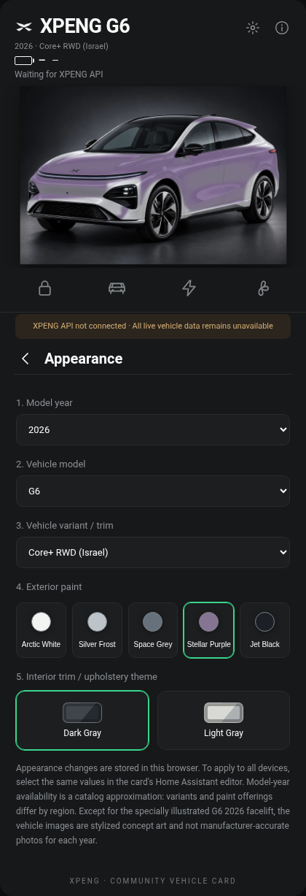

# XPENG Vehicle Card

**Custom Home Assistant Lovelace card for XPENG electric vehicles.** A dedicated dark vehicle interface with model-aware visuals, dedicated status pages, and a configurable exterior and full-cabin interior appearance.

> **Alpha • Community project • Read-only.** This card is **not an official XPENG product** and is not affiliated with XPENG Motors. It does not log in to the vehicle or implement remote commands. The companion `XPENG Direct` backend is a separate experimental project; a production-ready, authorized XPENG cloud connection has **not yet been verified**.


## Features

- Dedicated **Overview**, **Charging**, **Climate**, **Interior & seats**, **Controls**, **Vehicle information**, **Location** and **Tire pressure** pages.
- XPENG G6 2026 facelift visual with hood-mounted X mark, configurable trim and exterior paint.
- Interior finish option **Dark Gray** / **Light Gray**. The choice changes the dashboard, wheel, door inserts, centre console and all seats *together* in a vector cabin illustration. Exterior and interior styles are independent.
- Multiple XPENG models, model years and configurable vehicles. **Non-G6 model art is illustrative**; not manufacturer-accurate for every model or region.
- Reads configured Home Assistant states; `unknown`, `unavailable` and absent entities display as unavailable, **not as zero or fabricated vehicle values**.
- Vehicle controls are deliberately disabled. Steering-wheel heat, seat heating/ventilation/massage and other advanced actions are not treated as remotely controllable without a validated integration.
- Display-only personalisation; changing paint, trim or interior finish never changes the physical car.
- Language: initial card UI is English; Hebrew setup documentation is provided.

## Screenshots

| Vehicle | Charging & appearance | Interior finish |
|---|---|---|
|  |  |  |

Preview screenshots contain **demonstration data** and do not establish any live manufacturer API support.

## Installation

### HACS (custom repository; after first GitHub pre-release)

1. Open **HACS → ⋮ → Custom repositories** and enter this repository URL.
2. Select **Dashboard** category, download the card, then confirm the `xpeng-vehicle-card.js` resource is registered as a JavaScript module. HACS may register the resource automatically depending on the installed version.
3. Reload the browser (a hard refresh may be needed).
4. Edit your dashboard → Add Card → **Manual** and use the configuration below.

This repository declares `hacs.json` and packages the JS and images together under `dist/`. The default image URL is `/hacsfiles/xpeng-vehicle-card/assets`.

### Manual installation

1. Copy `dist/xpeng-vehicle-card.js` into `/config/www/xpeng-vehicle-card.js`.
2. Copy the **contents** of `dist/assets/` into `/config/www/xpeng/` (including subfolders).
3. In Home Assistant, add a Dashboard Resource: `/local/xpeng-vehicle-card.js`, type **JavaScript module**.
4. Set `image_path: /local/xpeng` on the card and reload the dashboard.

### Example configuration

```yaml
type: custom:xpeng-vehicle-card
prefix: my_xpeng
year: '2026'
model: G6
trim: core_plus_rwd
color: arctic_white
interior: light_gray
theme: dark
# image_path: /local/xpeng   # ONLY when installed manually
```

`prefix` should match entity IDs produced by your integration (for example, `sensor.my_xpeng_battery`). The default backend entity names are provisional: see [entity mapping and limitations](docs/ENTITY_MAPPING.md). You can also set individual entity mappings using `entities` in your card configuration.

## Personalisation

The built-in card editor allows choosing model year, XPENG model, trim, exterior paint, and interior finish. The in-card appearance page stores selection in the current browser; use the Home Assistant card editor to save a shared configuration across devices. Available paint and trim options are approximations and **must not be mistaken for a verified local sales catalogue**.

## Live data and limitations

The card is a **frontend component**. It cannot generate new sensors or discover undocumented endpoints. Live values require functioning entities supplied by Home Assistant. No authorized XPENG production API has been validated for this project. The visual vehicle controls are not functional; there are no hidden API requests. [Read the supported mapping principles](docs/ENTITY_MAPPING.md).

## Release status

- Version: `v0.5.0-alpha.3` — preview-quality release candidate, **not stable**.
- Checks: JS/JSON validation, asset verification, and browser regression tests defined in GitHub Actions.
- Remaining gate: green CI, real Home Assistant installation test, HACS custom-repository installation test, and future XPENG API verification for controls.
- Files: [Hebrew documentation](README_HE.md), [release checklist](RELEASE_CHECKLIST.md), [changes](CHANGELOG.md), [contributing](CONTRIBUTING.md), [security](SECURITY.md), [trademark statement](TRADEMARK.md).

## License and attribution

MIT for original project code (see `LICENSE`). XPENG brand names and marks remain the property of their owners. Original illustrative model images are **not guaranteed factory-accurate**. No affiliation or endorsement is claimed.