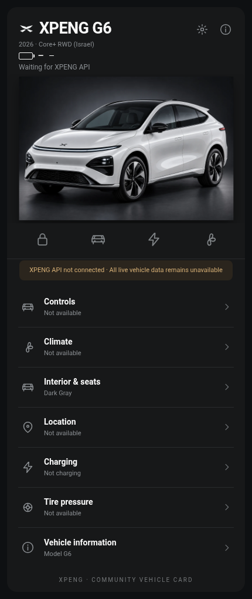

# XPENG Vehicle Card — כרטיס רכב ל־Home Assistant

**כרטיס Lovelace ייעודי לרכבי XPENG**, עם מסכים נפרדים, תצוגת רכב, טעינה, אקלים, מצב פתחים, לחץ צמיגים, מידע מתקדם ובחירת צבע חיצוני ופנימי.

> **גרסת Alpha ניסיונית וקריאה בלבד.** מדובר בפרויקט קהילתי שאינו רשמי ואינו קשור ליצרנית XPENG. אין כרגע חיבור ישיר מאומת לענן היצרן, והכרטיס אינו מפעיל פקודות רכב.



## מה קיים בכרטיס?

- **Overview** — הדמיית רכב, סוללה, טווח ומצב חיבור.
- **Charging** — אחוז סוללה, יעד טעינה, הספק טעינה ב־kW ואנרגיה ב־kWh רק כאשר קיימות ישויות אמיתיות עם הנתונים.
- **Climate** — תצוגת הקבינה, טמפרטורה ומצב אקלים כאשר קיימים חיישנים אמיתיים.
- **Interior & Seats** — בחירת Dark Gray או Light Gray ומשמעותה חזותית לכל הקבינה: הגה, דשבורד, דיפוני דלתות, קונסולה ומושבים קדמיים ואחוריים.
- **Controls** — תצוגת מצבי נעילה ופתחים, ללא כפתורי שליטה שאינם ממופים לפקודות מאומתות.
- **Vehicle Info / Location / Tire pressure** — ערכים רק מישויות Home Assistant קיימות.

חימום הגה, חימום/אוורור/עיסוי מושבים אינם פקדים פעילים עד לאימות יכולות ענן ישירות; עצם קיומם ברכב אינו מוכיח תמיכה ב־API.

## התקנה דרך HACS

לאחר העלאת גרסת Alpha למאגר GitHub:

1. פתח HACS → תפריט שלוש הנקודות → **Custom repositories**.
2. הזן את קישור המאגר ובחר קטגוריית **Dashboard**.
3. התקן, ודא שנוסף משאב JavaScript, ורענן את Home Assistant.
4. הוסף כרטיס **Manual** בדשבורד והדבק את ההגדרה הבאה.

```yaml
type: custom:xpeng-vehicle-card
prefix: my_xpeng
year: '2026'
model: G6
trim: core_plus_rwd
color: arctic_white
interior: dark_gray
theme: dark
```

## התקנה ידנית

1. העתק `dist/xpeng-vehicle-card.js` אל `/config/www/xpeng-vehicle-card.js`.
2. העתק את **תוכן** `dist/assets/` אל `/config/www/xpeng/` כולל תיקיות משנה.
3. הגדר משאב מסוג JavaScript module בכתובת `/local/xpeng-vehicle-card.js`.
4. הוסף להגדרת הכרטיס: `image_path: /local/xpeng`.

## תצוגה במסך מלא

לחצן Full screen בכותרת הכרטיס מאפשר הרחבה לתצוגת חלון מלאה וחזרה לתצוגה רגילה. הלחצן אינו שולח פקודות לרכב.

## התאמה אישית

מתוך עורך הכרטיס אפשר לבחור שנתון, דגם, רמת גימור, צבע מרכב וגימור פנים. בחירה בתוך מסך ההגדרות של הכרטיס יכולה להיות מקומית לדפדפן, ולכן עדיף לשמור בעורך הכרטיס כדי להחיל אותה גם באייפון ובמחשב. צבעים וזמינות גימורים תלויים בשוק, ולא כל שילוב אומת מול מפרטי היצרן השונים.

## מיפוי ונתוני רכב

הכרטיס **אינו יוצר סנסורים**. שמות הישויות לדוגמה הם מיפוי צפוי בלבד. אם חיישן חסר או אינו זמין, יוצג מקף / מצב חסר ולא ערך פיקטיבי. למידע נוסף: [עקרונות המיפוי](docs/ENTITY_MAPPING.md).

## מצב שחרור

`v0.5.0-alpha.3`: הכנה להפצה ניסיונית בלבד. לפני גרסה יציבה נדרשים בדיקות CI, התקנת HACS ושרת Home Assistant אמיתי. אינטגרציית XPENG Direct היא פרויקט נפרד; לא הוספנו לה גישה חדשה ל־API ולא המצאנו נתיבי שליטה.

[בדיקות שחרור](RELEASE_CHECKLIST.md) · [תיעוד באנגלית](README.md) · [שינויים](CHANGELOG.md)
