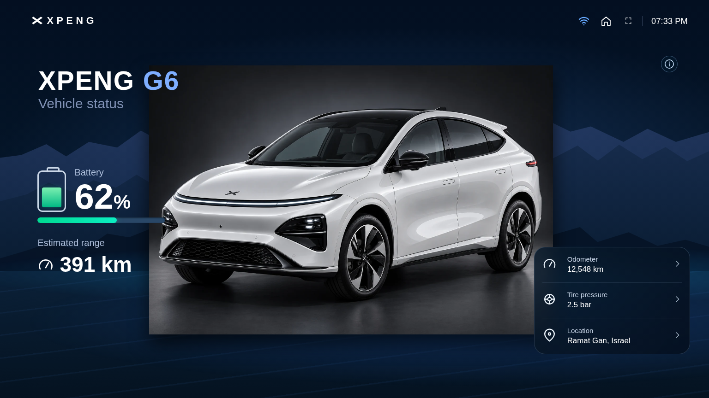
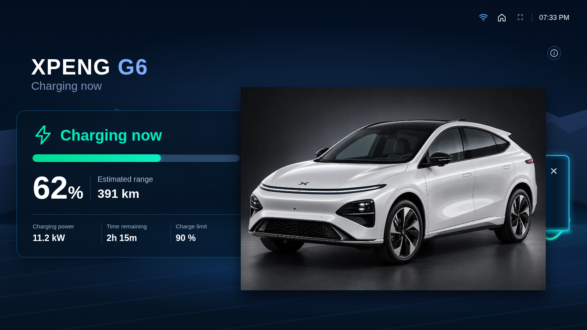

# XPENG Dashboard — גרסה ראשונית 0.1.1

זהו **כרטיס תצוגה עצמאי ל־Home Assistant**, ולא אינטגרציית התקשורת עם הרכב. אין צורך שאינטגרציית XPENG הניסיונית תעבוד כדי להגדיר את הכרטיס ולשייך לו חיישנים קיימים.

## שני מסכים בלבד

- **מצב הרכב** — אחוז סוללה, טווח נסיעה, קילומטראז', לחץ צמיגים ומיקום.
- **מצב טעינה** — אחוז סוללה, טווח, הספק טעינה, זמן שנותר ויעד טעינה.

המסכים מתחלפים אוטומטית לפי החיישן המשויך למצב הטעינה. זמינים גם מסך מלא ואייקון קטן למידע על העדכון האחרון.

## תמונות אמיתיות של הכרטיס

התמונות הבאות הופקו מהפעלת הכרטיס עצמו בדפדפן Chromium, עם **נתוני הדגמה של Home Assistant**, לא נתונים חיים של רכב.

| מצב הרכב | מצב טעינה |
| --- | --- |
|  |  |

[תצוגת נייד – מצב רכב](previews/dashboard-v011/phone-overview-DEMO.png) · [תצוגת נייד – טעינה](previews/dashboard-v011/phone-charging-DEMO.png)

## הגדרות — רק בעורך הכרטיס

בעורך הכרטיס בוחרים ידנית **דגם, שנתון, גימור, צבע חוץ וצבע פנים**. האפשרויות אינן מופיעות בדשבורד עצמו.

הקטלוג כולל **53 פרופילים של דגם־שנתון ב־16 רשומות**, כולל פרופיל כללי. לכל דגם ושנתון מוגדרות אפשרויות בחירה. חלק מהצבעים והתמונות עדיין **להמחשה בלבד** ואינם אישור לאפשרויות היצרן בישראל.

מקטע **Manual sensor mapping** מאפשר לשייך 15 חיישנים ידנית. אם משאירים שדה ריק, הכרטיס מנסה למצוא חיישן באופן אוטומטי לפי `prefix`. חיישנים שאינם קיימים יוצגו כלא זמינים ולא כנתונים מומצאים.

```yaml
type: custom:xpeng-vehicle-card
prefix: my_xpeng
model: G6
year: '2026'
trim: core_plus_rwd
color: arctic_white
interior: light_gray
entities:
  soc: sensor.my_battery
  charging: binary_sensor.my_charging
  range: sensor.my_range
grid_options:
  columns: full
  rows: auto
```

## התקנה

הוסיפו ב־HACS מאגר מסוג Dashboard:

[XPENG Vehicle Card](https://github.com/matanmesika/xpeng-vehicle-card)

ניתן לעבור לתצוגת מסך מלא. לעיצוב הכולל ולהרחבות עתידיות של תמונות מאומתות לכל שנתון ראו [משימת התמונות](https://github.com/matanmesika/xpeng-vehicle-card/issues/14).

**הערה:** תמונות ה־G6 שולבו עם רקע שקוף, אך תמונות אחרות עשויות להיות המחשות כלליות. הדשבורד לעולם אינו שולח פקודות לרכב.
