# XPENG G6 — מדריך הדשבורד המעודכן, v1.0.3

הכרטיס מתאים אוטומטית את אותה תצוגה למחשב, לטלפון ול־Home Assistant Sections. המקרא מתאר את **הכרטיס**, ולא שינוי באינטגרציית הרכב עצמה.

## צילומים מתוך בדיקות הדפדפן

| חלון | מחשב | טלפון |
| --- | --- | --- |
| בית | 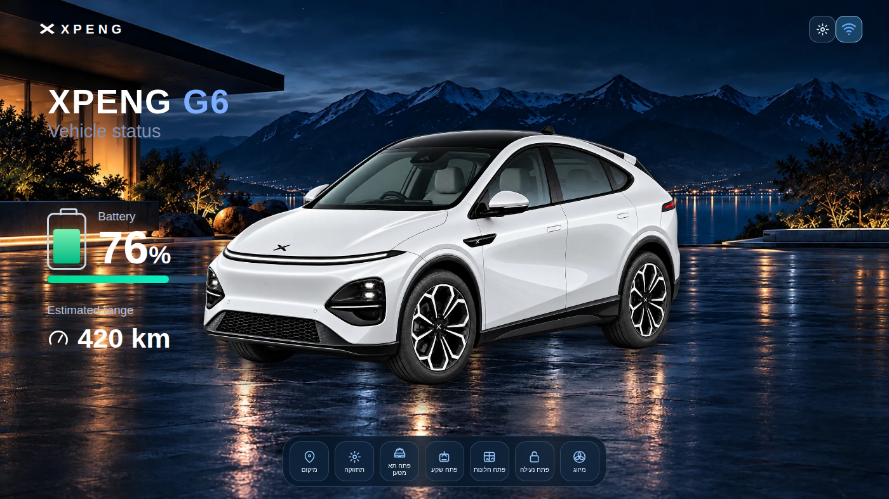 | 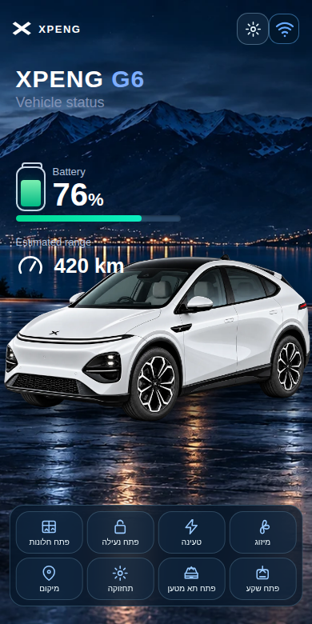 |
| טעינה | 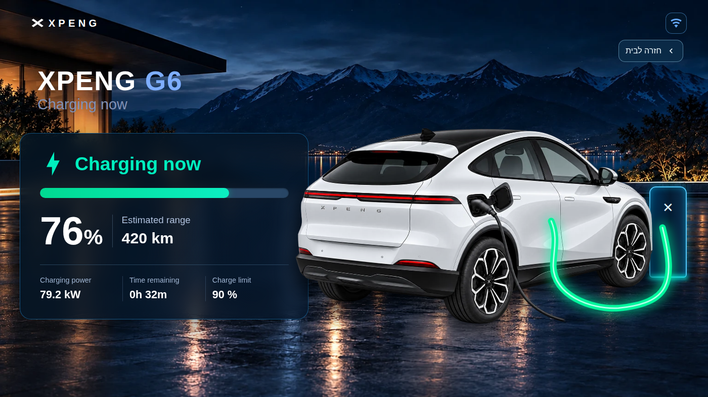 | 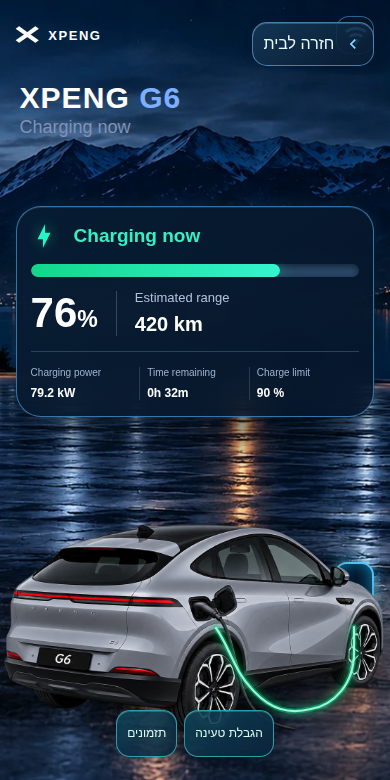 |
| מיזוג — פנים בהיר | 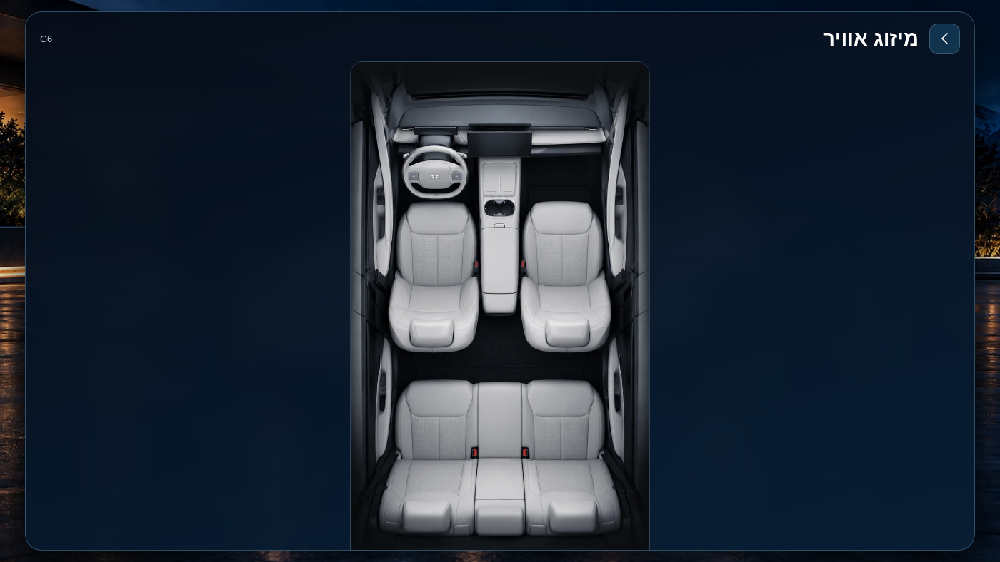 | 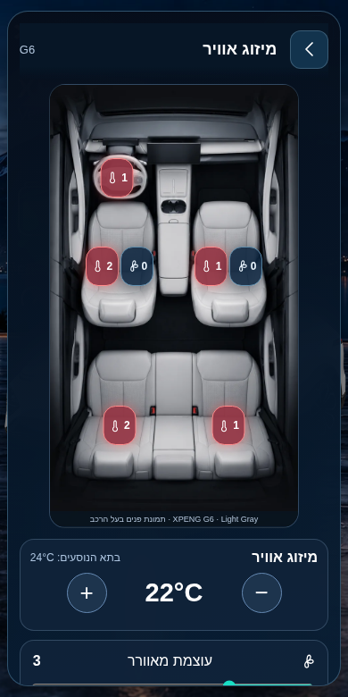 |
| מיזוג — פנים כהה | 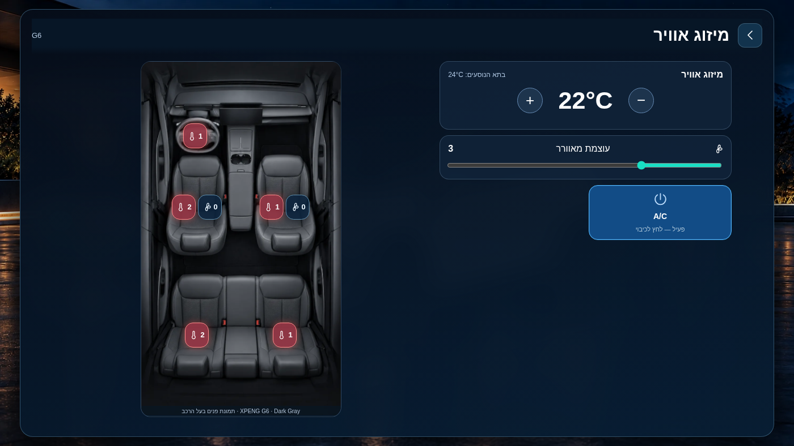 | 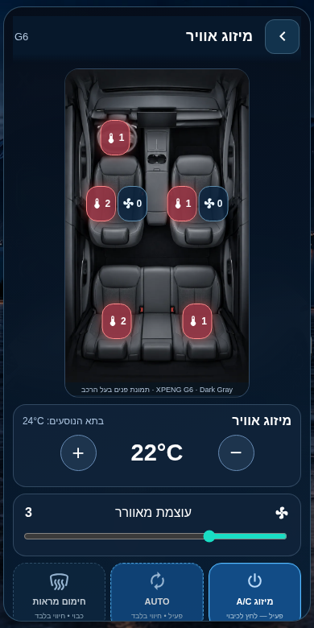 |
| מיקום | 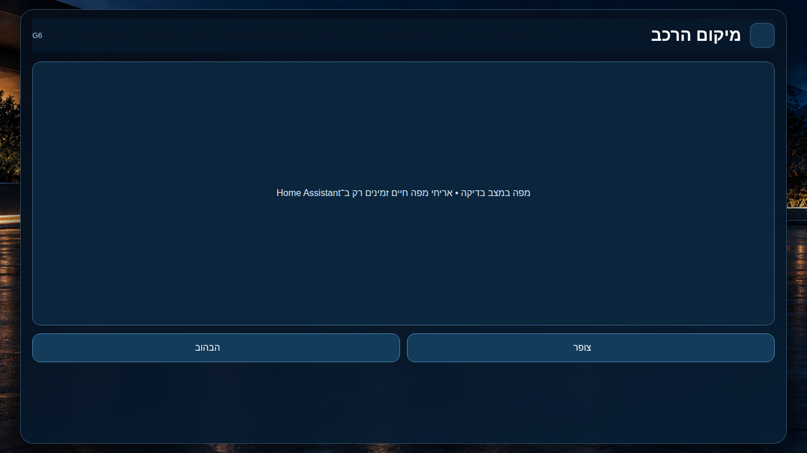 | 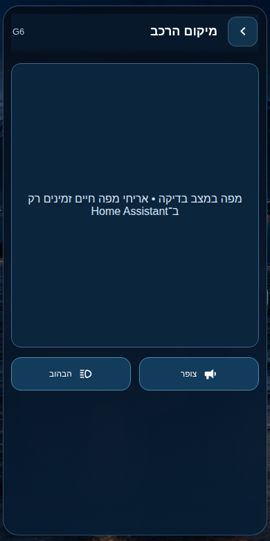 |
| תחזוקה | 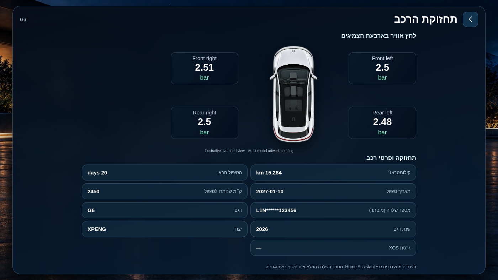 | 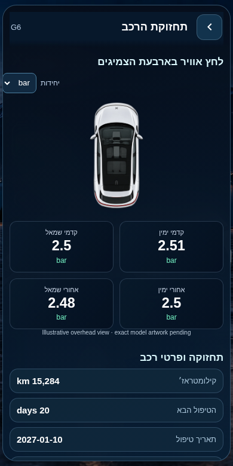 |

אלה צילומי Chromium של **הקוד האמיתי** עם נתוני דוגמה. לא מדובר בתמונות מדשבורד הרכב החי. באזור המפה מוצג רכיב מדומה משום שהבדיקה העצמאית אינה מפעילה את רכיב המפה של Home Assistant.

## שמונת הכפתורים בדף הבית

| כפתור | מה עושה |
| --- | --- |
| מיזוג | מציג מיזוג, טמפרטורה, מהירות מאוורר, חימום/אוורור המושבים וחימום ההגה |
| טעינה | נתוני טעינה, הגבלת טעינה ותזמוני טעינה לקריאה |
| נעילה | לחיצה אחת לנעילה/פתיחה לפי מצב חיישן הנעילה |
| חלונות | לחיצה אחת לפתיחה/סגירה לפי מצב החיישן |
| שקע טעינה | פתיחה/סגירה בהתאם למצב השקע, ללא סגירה כאשר הכבל מחובר |
| תא מטען | פתיחה/סגירה לפי חיישן מצב תא המטען |
| תחזוקה | לחץ ארבעת הצמיגים, קילומטראז׳, הטיפול הבא ומספר שלדה מוסתר |
| מיקום | מפה כהה עם מיקום הרכב, שני כפתורים — צופר והבהוב |

במסכי המשנה קיים רק לחצן חזרה לבית; התפריט של דף הבית מוסתר.

## מיזוג אוויר

תמונות פנים הרכב המקוריות נמצאות בנתיבים:
- assets/vehicles/g6/interior_light_gray.webp
- assets/vehicles/g6/interior_dark_gray.webp

צבע הפנים נקבע בהגדרות הכרטיס. רק ישויות שקיימות באינטגרציה יוצגו ויפעלו. בשני המושבים הקדמיים יש חימום ואוורור לפי התמיכה ברכב; בשני המושבים האחוריים חימום עצמאי; בהגה חימום.

**AUTO** מוצג כחיווי בלבד כאשר האינטגרציה מפרסמת רק חיישן AUTO ולא פקודה עצמאית. בורר מהירות המאוורר מציג את הטווח שחיישן Home Assistant מדווח, ולכן לא קובעים מראש 8 או 10 דרגות. לא תוצג בקרה מזויפת לכיוון אוויר או להפשרה אחורית.

## טעינה ומיקום

שמרנו על פריסת הנתונים של הטעינה. הוספנו שני קיצורים בלבד: **הגבלת טעינה** ו**תזמונים**. עריכת תזמונים אינה נתמכת כרגע על ידי פקודת אינטגרציה מאומתת.

מסך המיקום נפתח גם במחשב וגם בטלפון. הוא מבקש את רכיב המפה המובנה של HA, במצב כהה וברמת זום 11, עם מיקום הרכב. שני הכפתורים **צופר** ו**הבהוב** דורשים פעולה יזומה ואישור. יש לאמת את המפה החיה רק לאחר התקנה בסביבת Home Assistant.

## איך להתקין

1. Home Assistant → HACS → מאגר מותאם אישית מסוג Dashboard: https://github.com/matanmesika/xpeng-vehicle-card.
2. עדכן XPENG Vehicle Card ל־v1.0.3 ורענן את האפליקציה/הדפדפן.
3. בעריכת הכרטיס בחר G6, שנת הרכב, צבע חיצוני וצבע פנים. ודא שה־prefix זהה לשמות הישויות שלך. לדוגמה: xpeng_g6.
4. רק אם תרצה לאפשר פתיחת חלונות, שחרור נעילה ופתיחת תא מטען, הגדר enable_access_controls: true ואשר Access גם באינטגרציה.
5. ודא בדשבורד האמיתי שהמפה, הצופר, ההבהוב, חימום המושבים, שקע הטעינה ותא המטען עובדים. בדיקות הדפדפן אינן שולחות פקודות לרכב.

גרסת המקור הראשית: [XPENG Vehicle Card](https://github.com/matanmesika/xpeng-vehicle-card) · [הערות שחרור](releases/v1.0.3.md).

## תיקוני תצוגת הטלפון ויחידות צמיגים — ענף בדיקה PR #43

לכל דגם, שנת ייצור וצבע קיימים שלושה קבצים נפרדים: `front.webp` למסך הבית, `charging.webp` למסך הטעינה המקורי, ו־`top.webp` לתחזוקה וללחץ צמיגים. אין להחליף את תמונת הטעינה בתמונת החזית.

בטלפון שמונת כפתורי הבית נגללים בהחלקה ימינה ושמאלה; מסכי המיזוג, המיקום והתחזוקה נגללים מעלה ומטה. תחזוקת הצמיגים מסודרת מתחת לתמונת הרכב בשתי עמודות ובשתי שורות.

מעל הצמיגים אפשר לבחור `bar`, `PSI` או `kPa`. אותה יחידה ניתנת להגדרת ברירת מחדל בעורך הכרטיס. האינטגרציה Xpengtk מספקת כברירת מחדל kPa: שמות המקור הם `tyre_pressure_fl/fr/rl/rr`. אם חיישן מופיע כלא זמין, יש לבדוק ב־Home Assistant → כלים למפתחים → מצבים את שמו ואת הנתון המדווח. הממשק אינו מציג נתון מומצא כשהמקור אינו זמין.

כל אייקוני הפעולות משתמשים כעת בסמלים התקניים של Home Assistant (`mdi:`), כולל אייקון המאוורר, במקום קווי SVG מצוירים ידנית. איורים המשמשים בתור *תמונת רכב* לא הוחלפו באייקונים.

תיקונים אלה עדיין בטיוטת [PR #43](https://github.com/matanmesika/xpeng-vehicle-card/pull/43), ולא פורסמו בגרסת HACS יציבה חדשה עד סיום הבדיקות.
