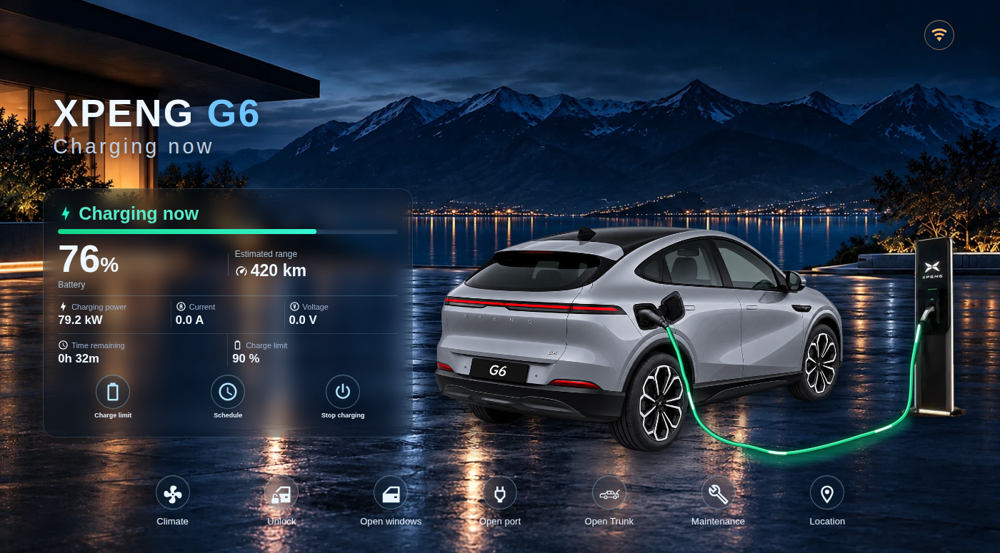
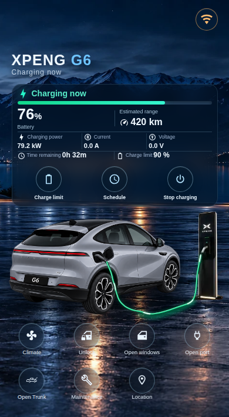

# XPENG Vehicle Card v1.0.7 — Stable

Stable HACS release following v1.0.6. It promotes the owner-approved v1.0.7 beta line (beta.1–beta.7) and adds the realistic continuous charging cable.

## Charging scene
- **One continuous, realistic cable.** It runs from the station holster handle, down to the station foot, along the floor, and up to the plug's rubber boot.
- The drawn cable exactly covers the cable pictured in the G6 2026 artwork, so there is never a second cable over the photo.
- It is laid out from the real on-screen car and station boxes, and stays attached on phone, tablet and desktop and after resizing.
- **Only real charging is shown.** While charging, the whole cable is coloured end to end, with energy flowing station → car. Charging requires the charging state **and** reported power above 0 kW, so a plugged-in but idle car (0 kW) never shows the charging scene.
- Round-cable shading, a floor contact shadow and a flush, masked start at the plug.
- The flow keeps running across Home Assistant updates. `prefers-reduced-motion` is respected.

## From the v1.0.7 betas
- Capability-guarded On/Off controls for seven G6 climate modes. They appear only when Xpengtk reports `control_allowed: true`.
- Rename-resilient Xpengtk entity mapping through the Entity Registry, and a complete manual sensor-mapping editor.
- Observed Xpengtk aliases. Supports both unified covers and separate per-action sensors/buttons for the trunk, windows and charge port.
- The AC current limit is shown separately from the battery charge limit. Fan speed is read-only when only a sensor exists.
- Compact phone charging panel and heading that stay clear of the vehicle.

## HACS / GitHub screenshots
All 14 gallery screenshots in `docs/screenshots/` are recaptured from the **actual v1.0.7 card in Chromium** with simulated Xpengtk entities.

## Installation
In HACS, open XPENG Vehicle Card → Update (or Redownload) → **v1.0.7**. Refresh the Home Assistant frontend, and clear its cached JS bundle if necessary.

## Validation and limitations
The release workflow verifies:
- source/dist parity;
- the regression suites;
- real Chromium desktop/iPhone geometry, including the continuous cable path from station handle to plug;
- the curated screenshot PNGs.

Browser tests use simulated vehicle states. They do not establish live-car execution or iPhone Safari behaviour.
